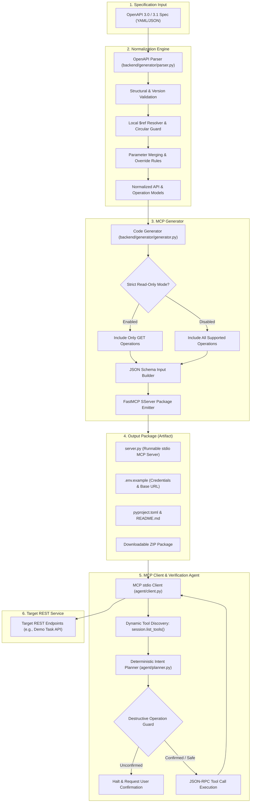
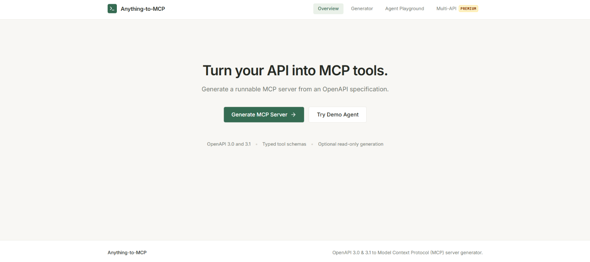
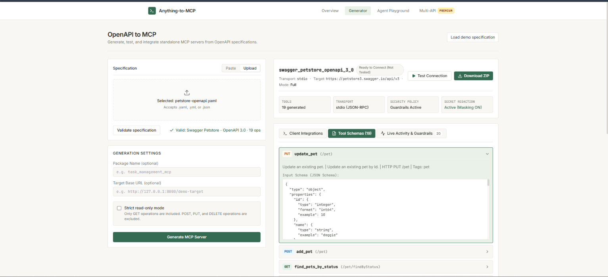
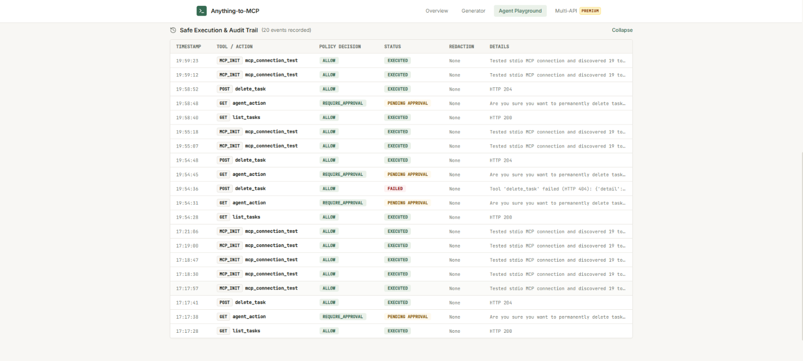
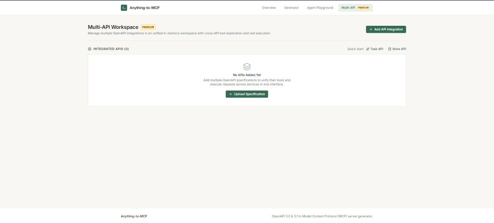

# Anything-to-MCP

Turn any OpenAPI 3.0 or 3.1 specification into a production-grade, typed Model Context Protocol (MCP) server runnable over stdio.

Equip Claude Desktop, Cursor, and LLM agents with verifiable tool invocations, typed input schemas, strict read-only safeguards, and runtime authentication.

---

## 1. Project Overview & Actual Capabilities

**Anything-to-MCP** is an end-to-end developer platform for generating and executing Model Context Protocol servers directly from OpenAPI specifications:

- **OpenAPI 3.0.x & 3.1.x Support**: Native YAML and JSON parsing, circular reference resolution, parameter merging, and local `$ref` resolution.
- **Typed MCP Tool Schemas**: Automatic translation of path parameters, query parameters, and complex JSON request bodies into standard JSON Schemas.
- **Strict Read-Only Mode**: Toggle-safe generation that isolates idempotent `GET` operations and excludes mutating `POST`, `PUT`, `PATCH`, and `DELETE` requests.
- **Official Python MCP SDK**: Generated servers adhere strictly to standard public APIs (`mcp.server.fastmcp`) using stdio transport.
- **Specification Evolution**: Regenerate existing servers in-place when upstream API schemas evolve, automatically preserving local `.env` authentication credentials.
- **Deterministic Agent Playground**: Built-in verification agent with mandatory confirmation safeguards that prevent destructive actions without explicit user approval.
- **Production Developer Web App**: Modern React + Vite + TypeScript + Tailwind CSS developer workspace.

---

## 2. Architecture Diagram



---

## 3. Repository Structure

```text
D:\MVP\
├── .env.example             # Environment configuration template
├── Dockerfile               # Multi-stage production container build
├── docker-compose.yml       # Production/local service orchestration
├── pyproject.toml           # Backend Python dependencies and CLI entrypoints
├── README.md                # Project documentation
├── agent/                   # MCP stdio client and deterministic agent planner
│   ├── client.py            # Async stdio MCP client using official MCP SDK
│   ├── planner.py           # Deterministic natural-language intent planner
│   └── agent.py             # Agent runtime with destructive operation confirmation
├── backend/                 # Core backend service and generator
│   ├── app/                 # FastAPI application service
│   │   ├── main.py          # Application initialization, CORS, and routing
│   │   ├── api/v1/          # Generator API, agent adapter, and schemas
│   │   └── services/        # Storage isolation, metadata, and ZIP archives
│   ├── generator/           # Standalone OpenAPI parsing and MCP generator engine
│   │   ├── parser.py        # YAML/JSON parser, ref resolution, parameter merging
│   │   ├── generator.py     # Code generator emitting public FastMCP servers
│   │   ├── evolution.py     # Specification diffing and .env preserving regenerator
│   │   └── cli.py           # CLI entrypoint for generator
│   └── tests/               # 106 automated unit, integration, and E2E tests
├── demo_api/                # Deterministic in-memory Task Management sample API
│   ├── app.py               # FastAPI demo endpoints with explicit operationIds
│   ├── models.py            # Pydantic schemas for tasks and projects
│   └── repository.py        # Thread-safe in-memory task repository with seed data
├── docs/                    # Architectural guides and live demonstration scripts
│   ├── ARCHITECTURE.md      # Detailed architectural breakdown and design decisions
│   └── DEMO_SCRIPT.md       # Step-by-step 5-7 minute hackathon live demo script
├── examples/                # Bundled OpenAPI specifications for testing
│   ├── task_management_api.yaml   # Bundled demo OpenAPI 3.0 specification
│   ├── evolution_updated.yaml     # Evolved specification with new/renamed tools
│   └── openapi_31_petstore.json   # OpenAPI 3.1 JSON test specification
├── frontend/                # React + Vite + TypeScript + Tailwind CSS application
│   ├── src/                 # Application source code
│   │   ├── api/             # Typed API client and data models
│   │   ├── components/      # Navbar, Footer, and shared UI components
│   │   └── views/           # LandingPage, GeneratorWorkspace, AgentPlayground
│   └── package.json         # Frontend dependencies and build scripts
└── scripts/                 # Utility demonstration scripts
    ├── demo_evolution.py    # Automated specification evolution demo
    └── generate_demo_server.py # Quick script to generate demo MCP server
```

---

## 4. Prerequisites

- **Python**: 3.10+ (tested on Python 3.14.3)
- **Node.js**: v18+ (tested on Node v24.13.1, npm 11.8.0)
- **Operating System**: Windows PowerShell, macOS, or Linux
- **Git**

---

## 5. Clean Installation Instructions

### Windows (PowerShell)

```powershell
# 1. Clone repository and navigate to root
cd D:\MVP

# 2. Create and activate Python virtual environment
python -m venv .venv
.venv\Scripts\Activate.ps1

# 3. Install backend dependencies in editable mode
pip install -e .

# 4. Install frontend dependencies and build static assets
cd frontend
npm install
npm run build
cd ..

# 5. Configure environment variables
copy .env.example .env
copy frontend\.env.example frontend\.env
```

### macOS / Linux

```bash
# 1. Clone repository and navigate to root
cd /path/to/MVP

# 2. Create and activate Python virtual environment
python3 -m venv .venv
source .venv/bin/activate

# 3. Install backend dependencies in editable mode
pip install -e .

# 4. Install frontend dependencies and build static assets
cd frontend
npm install
npm run build
cd ..

# 5. Configure environment variables
cp .env.example .env
cp frontend/.env.example frontend/.env
```

---

## 📸 Screenshots

### 🏠 Home Page


### ⚙️ MCP Server Generator


### 📜 History


### ✨ Premium Features


## 6. Commands to Run

### A. Run Generator API & Backend
Starts the FastAPI server (which also mounts `/demo-target` and hosts the prebuilt React frontend):
```powershell
uvicorn backend.app.main:app --host 127.0.0.1 --port 8000 --reload
```

### B. Run Frontend in Development Mode
Starts the Vite development server with hot module reloading:
```powershell
cd frontend
npm run dev
```

### C. Run the Standalone Demo API (if testing in isolation)
```powershell
uvicorn demo_api.main:app --host 127.0.0.1 --port 8000
```

### D. Run the MCP Agent CLI Demo
Executes 9 automated end-to-end scenarios verifying discovery, queries, creation, and safety guards:
```powershell
python demo.py
```
*For interactive REPL mode*:
```powershell
python demo.py --interactive
```

### E. Run the Specification Evolution Demo
Demonstrates in-place package regeneration and `.env` secret preservation:
```powershell
python scripts/demo_evolution.py
```

### F. Run the Full Automated Test Suite
Executes all 153 automated tests:
```powershell
pytest -v
```

---

## 7. Exact Local URLs & Health Checks

| Service | Local URL | Health Check / Documentation |
|---|---|---|
| **Web Interface (Vite Dev)** | [http://localhost:5173](http://localhost:5173) | Frontend Application |
| **Unified Service (FastAPI + Static UI)** | [http://127.0.0.1:8000](http://127.0.0.1:8000) | Root mounts React `index.html` |
| **Backend Health Check** | [http://127.0.0.1:8000/health](http://127.0.0.1:8000/health) | Returns `{"status":"ok","service":"anything-to-mcp"}` |
| **Generator API v1 Health** | [http://127.0.0.1:8000/api/v1/health](http://127.0.0.1:8000/api/v1/health) | Returns generator version & timestamp |
| **Interactive API Docs (Swagger)** | [http://127.0.0.1:8000/docs](http://127.0.0.1:8000/docs) | OpenAPI interactive documentation |
| **Demo Target API** | [http://127.0.0.1:8000/demo-target/tasks](http://127.0.0.1:8000/demo-target/tasks) | Seed task repository |

---

## 8. How to Upload, Validate, Generate, and Download

### Via Web Interface
1. Navigate to **Generator Workspace** at [http://localhost:5173](http://localhost:5173).
2. Choose **Upload File** (select `.yaml`, `.yml`, or `.json`) or **Paste Spec**, or click **"Try Task Management API Demo"** to load the bundled example.
3. Click **"Validate Spec"** to view API metadata, operations count, and error reports.
4. Optionally customize the Package Name, Target API Base URL, or toggle **Strict Read-Only Mode**.
5. Click **"Generate MCP Server"**.
6. Inspect the discovered tool schemas and click **"Download ZIP"** to save the package.

### Via Command-Line Interface (CLI)
```powershell
# Basic generation
anything-to-mcp generate examples/task_management_api.yaml -o generated/my_mcp

# Strict read-only mode
anything-to-mcp generate examples/task_management_api.yaml -o generated/readonly_mcp --read-only

# Custom package name and base URL
anything-to-mcp generate examples/task_management_api.yaml -n custom_tasks -b http://api.service.com -o generated/custom
```

### Via HTTP API
```bash
# 1. Validate
curl -X POST "http://127.0.0.1:8000/api/v1/specs/validate" \
     -H "Content-Type: application/json" \
     -d '{"spec": "openapi: 3.0.3\ninfo:\n  title: Example\n  version: 1.0.0\npaths: {}"}'

# 2. Generate
curl -X POST "http://127.0.0.1:8000/api/v1/servers/generate" \
     -F "file=@examples/task_management_api.yaml" \
     -F "package_name=tasks_mcp"

# 3. Download
curl -O -J "http://127.0.0.1:8000/api/v1/servers/<GENERATION_ID>/download"
```

---

## 9. How to Configure Authentication via `.env`

**Security Notice**: Credentials are never sent to the Anything-to-MCP generator service.

All authentication headers are injected at runtime by the generated MCP server. After downloading and extracting your generated package:

1. Locate `.env.example` inside the package directory.
2. Copy it to `.env`:
   ```powershell
   copy .env.example .env
   ```
3. Set your target credentials:
   ```env
   # API Key Authentication
   API_KEY=your_secret_api_key_here

   # Bearer Token Authentication
   BEARER_TOKEN=your_jwt_or_oauth_token_here

   # Base URL Override (Optional)
   TARGET_BASE_URL=https://api.yourdomain.com
   ```
The generated HTTP execution layer automatically injects these headers into outgoing requests according to the authentication schemes defined in the original specification.

---

## 10. How to Run a Generated MCP Server

Generated packages are standalone Python projects using the official Python MCP SDK.

```powershell
# 1. Navigate to the extracted package directory
cd generated/task_management_mcp

# 2. Create and activate a local virtual environment
python -m venv .venv
.venv\Scripts\Activate.ps1

# 3. Install dependencies
pip install -e .

# 4. Start the MCP server over stdio
python server.py
```

### Connect to Claude Desktop
Add the following to your `claude_desktop_config.json`:
```json
{
  "mcpServers": {
    "task-management": {
      "command": "D:\\MVP\\.venv\\Scripts\\python.exe",
      "args": ["D:\\MVP\\generated\\task_management_mcp\\server.py"],
      "env": {
        "TARGET_BASE_URL": "http://127.0.0.1:8000/demo-target"
      }
    }
  }
}
```

---

## 11. Strict Read-Only Mode

Strict Read-Only Mode ensures that LLM clients cannot inadvertently modify remote data:

- When enabled, the generator excludes all non-`GET` operations (e.g. `POST`, `PUT`, `PATCH`, `DELETE`).
- Only idempotent queries (such as `list_tasks`, `get_task_by_id`, `get_summary`) are exposed as tools.
- CLI flag: `--read-only` or `-r`.
- Web UI: Toggle switch under **Configuration Options**.
- Generated code contains zero mutation routes, providing structural protection at the tool registration layer.

---

## 12. Specification Evolution & Regeneration

When upstream APIs change, update existing generated MCP servers without losing local configurations:

```powershell
python scripts/demo_evolution.py
```

### Evolution Safeguards:
1. **Added Endpoints**: New API paths automatically generate new MCP tools.
2. **Removed Endpoints**: Deprecated routes are cleanly removed from tool discovery.
3. **Renamed Operations**: Changed `operationId`s update tool names and descriptions.
4. **Schema Updates**: Parameter or request body additions update JSON Schemas.
5. **Config Preservation**: Existing `.env` files and developer secrets are never overwritten during regeneration.
6. **Atomic Guarantee**: Specifications are staged and validated in memory before writing to disk. If an updated specification is invalid, the existing running package remains 100% untouched.

---

## 13. Supported Features & Known Limitations

### Supported
- OpenAPI 3.0.0 through 3.0.3 and OpenAPI 3.1.0 specifications.
- Input formats: YAML (`.yaml`, `.yml`) and JSON (`.json`).
- Path parameters, query parameters, header parameters, and JSON request bodies.
- HTTP methods: `GET`, `POST`, `PUT`, `PATCH`, `DELETE`.
- Authentication: API Key (header/query) and Bearer tokens.
- Internal local `$ref` resolution with circular reference protection.
- stdio transport over standard JSON-RPC.

### Limitations
- **External Remote References**: Remote references (`http://`, `https://`) are strictly rejected to prevent SSRF vulnerabilities.
- **Multipart Form Uploads to Target APIs**: Target APIs requiring binary file uploads in request bodies are currently unsupported.
- **Remote MCP Transports**: Server-Sent Events (SSE) and HTTP streaming transports are on the roadmap; current generated servers run via stdio.
- **Ephemeral Storage**: When hosted on ephemeral containers (e.g. basic cloud dynos), downloaded ZIP archives in `storage/artifacts` expire when the container restarts. Mount persistent volumes for durable storage.

---

## 14. Deployment Readiness & Environment Variables

### Environment Variables

| Variable | Description | Default |
|---|---|---|
| `HOST` | Bind host address | `127.0.0.1` |
| `PORT` | Bind port number | `8000` |
| `ALLOWED_ORIGINS` | Comma-separated list of allowed CORS origins | `http://localhost:5173,...` |
| `GENERATOR_STORAGE_DIR` | Directory for generated ZIP artifacts | `storage/artifacts` |
| `DEMO_API_BASE_URL` | Base URL for demo target API calls | `http://127.0.0.1:8000/demo-target` |
| `VITE_API_BASE_URL` | Frontend URL pointing to FastAPI backend | `http://127.0.0.1:8000` |

### Docker Deployment
The repository includes a production multi-stage `Dockerfile`:
```bash
# Build and run container
docker build -t anything-to-mcp .
docker run -p 8000:8000 -e ALLOWED_ORIGINS="http://localhost:8000" anything-to-mcp
```
Or with Docker Compose:
```bash
docker-compose up -d
```

---

## 15. Troubleshooting Common Errors

### 1. `Swagger 2.0 is not supported`
- **Cause**: The input specification declares `swagger: "2.0"`.
- **Solution**: Convert your specification to OpenAPI 3.0+ using an online converter or `swagger2openapi`.

### 2. `Tool failed: Failed to connect to target API`
- **Cause**: The target API URL configured in `TARGET_BASE_URL` is unreachable or offline.
- **Solution**: Confirm your target service is running. If using the demo API, ensure `DEMO_API_BASE_URL` is set to `http://127.0.0.1:8000/demo-target`.

### 3. `Destructive operation blocked`
- **Cause**: The agent attempted a `DELETE` or reset operation without confirmation.
- **Solution**: In the Agent Playground, click **"Confirm & Execute Action"** to authorize the mutation. In CLI REPL mode, enter `yes` when prompted.

### 4. `CORS Network Error in Browser`
- **Cause**: The frontend origin is not present in `ALLOWED_ORIGINS`.
- **Solution**: Add your frontend URL (e.g., `http://localhost:5173`) to `ALLOWED_ORIGINS` in `.env` and restart the backend.

---

## Verification & Test Results

The backend test suite verifies the complete pipeline with **106 passing tests**:

```powershell
pytest -v
============================= 106 passed in 26.86s =============================
```
