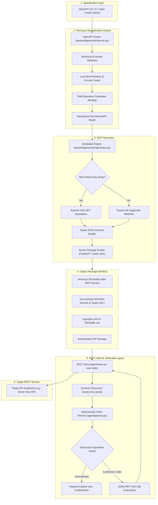

# Anything-to-MCP: System Architecture

This document provides a comprehensive technical overview of **Anything-to-MCP**, explaining the system pipeline, runtime models, security constraints, and execution boundaries.

---

## 1. System Pipeline Overview

---

## 2. Component Breakdown

### A. Parser & Normalizer (`backend/generator/parser.py`)
- **Version Compatibility**: Supports OpenAPI 3.0.x and 3.1.x in both YAML and JSON formats. Rejects Swagger 2.0 with informative migration guidance.
- **Reference Resolution**: Resolves internal local `$ref` pointers (e.g. `#/components/schemas/Task`) while guarding against infinite circular data structures via visited-reference tracking. External remote `$ref`s are rejected to prevent SSRF vulnerabilities.
- **Parameter Merging**: Correctly merges path-level parameters with operation-level parameter overrides according to OpenAPI specification rules.
- **Tool Identifier Normalization**: Generates clean, predictable snake_case MCP tool names derived from `operationId`, or falls back to `{method}_{path_slug}` when `operationId` is absent.

### B. MCP Server Code Generator (`backend/generator/generator.py`)
- **Official SDK Compliance**: Emits runnable Python server packages utilizing the public API of the official Python `mcp` SDK (`FastMCP` / `@mcp.tool()`). Avoids any reliance on private SDK internals.
- **Typed Input Schemas**: Converts OpenAPI path parameters, query parameters, and JSON request bodies into complete JSON Schemas with explicit field types (`string`, `integer`, `number`, `boolean`, `array`, `object`), descriptions, and required constraints.
- **Strict Read-Only Mode**: A dedicated generation mode that strictly filters out non-GET operations (POST, PUT, PATCH, DELETE). This guarantees that agents running against read-only packages cannot mutate state.
- **Runtime Authentication**: Generated servers read `API_KEY` or `BEARER_TOKEN` from local environment variables or `.env` files. Secrets are never transmitted to the generator web service.

### C. Artifact Storage & Evolution Service (`backend/app/services/storage.py`, `backend/generator/evolution.py`)
- **Storage Isolation**: Each generation creates an isolated UUID directory under `storage/artifacts/`.
- **Security Guardrails**: Generation IDs and package names are strictly validated with alphanumeric and UUID regular expressions to prevent path traversal attacks.
- **Specification Evolution**: Upstream schema changes can be applied to update generated tools. The evolution engine preserves user-configured `.env` secrets across updates while detecting added, removed, or modified operations.

### D. Agent Client & Deterministic Intent Planner (`agent/`)
- **MCP stdio Transport**: Connects to the generated `server.py` via asynchronous subprocess pipes using standard MCP stdio JSON-RPC protocol (`stdio_client`).
- **Dynamic Tool Discovery**: Queries the running MCP server dynamically using `session.list_tools()`. Does not hardcode tools in the client.
- **Deterministic Intent Planner**: Maps natural-language user requests to discovered MCP tools without requiring external third-party LLM API keys. Verifies argument presence and type requirements.
- **Destructive Operation Confirmation Safeguard**: Intercepts destructive actions (such as `delete_task` or database resets). If `confirm_destructive=False`, the agent halts execution, leaves data intact, and returns an actionable confirmation request.

### E. Generator HTTP API & Agent Adapter (`backend/app/`)
- **FastAPI Endpoints**:
  - `GET /health` & `GET /api/v1/health`: Operational health check.
  - `POST /api/v1/specs/validate`: Validates uploaded specs and returns operation summaries.
  - `POST /api/v1/servers/generate`: Generates package and prepares ZIP download.
  - `GET /api/v1/servers/{generation_id}/tools`: Returns dynamic tool metadata.
  - `GET /api/v1/servers/{generation_id}/download`: Streams ZIP archive download.
  - `GET /api/v1/demo/spec`: Serves bundled Task Management demo specification.
  - `GET /api/v1/agent/status`: Reports readiness and live seed task counts.
  - `GET /api/v1/agent/tools`: Exposes dynamically discovered MCP tools over stdio.
  - `POST /api/v1/agent/execute`: Safely dispatches natural language prompts to MCPAgent.
  - `POST /api/v1/agent/reset`: Resets demo data store after verified confirmation.

### F. Developer Web Interface (`frontend/`)
- **React + Vite + TypeScript + Tailwind CSS**: Near-black/charcoal theme with violet and coral accents.
- **Unified Views**:
  - **Overview**: High-level problem statement, workflow steps, feature highlights, and architecture flow.
  - **Generator Workspace**: Multi-format spec input (file upload / text paste / one-click demo load), live syntax & schema validation, read-only toggle, real tool schema inspector, and ZIP package download.
  - **Agent Playground**: Natural language prompt runner, status monitor, discovered tool parameters drawer, destructive action safeguard cards, and seed database reset.

---

## 3. Implemented Capabilities vs. Future Roadmap

| Capability | Current Status | Details |
|---|---|---|
| **OpenAPI 3.0 / 3.1 Parsing** | Implemented | YAML & JSON formats, parameter merging, local `$ref` resolution |
| **Strict Read-Only Generation** | Implemented | Strict filtering of non-GET operations |
| **Typed JSON Schemas** | Implemented | Parameters & request bodies converted to JSON Schema |
| **Runnable stdio MCP Server** | Implemented | Official Python MCP SDK (`mcp.server.fastmcp`) |
| **FastAPI Generator HTTP API** | Implemented | Validation, generation, inspection, and ZIP download endpoints |
| **Specification Evolution** | Implemented | Package updating with `.env` secret preservation |
| **MCP stdio Client & Agent** | Implemented | Subprocess stdio transport, dynamic discovery, safety guards |
| **Web UI (React + Tailwind)** | Implemented | Landing page, Generator workspace, and Agent playground |
| **SSE / HTTP MCP Transport** | Roadmap | Streamable remote MCP transport (currently stdio) |
| **Multi-File OpenAPI Specs** | Roadmap | Bundling external `$ref` across multiple remote files |
| **General LLM Orchestration** | Roadmap | Pluggable Anthropic/OpenAI function calling adapters |
